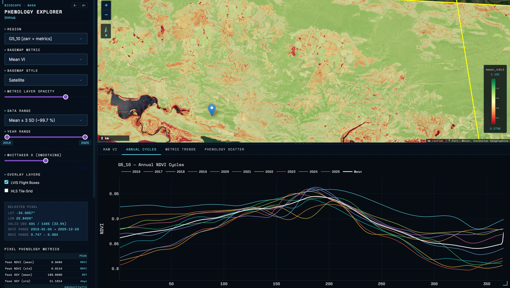
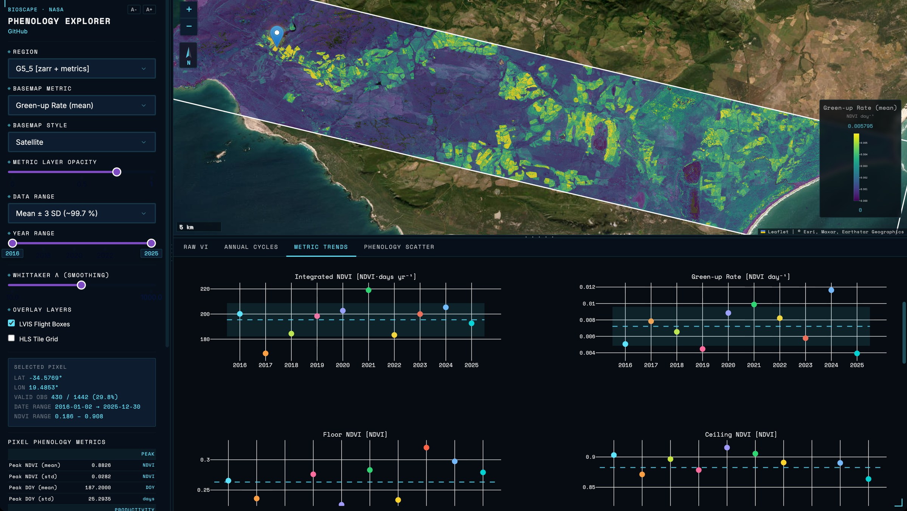
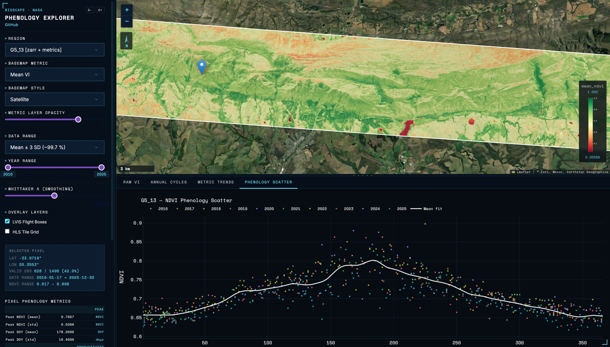
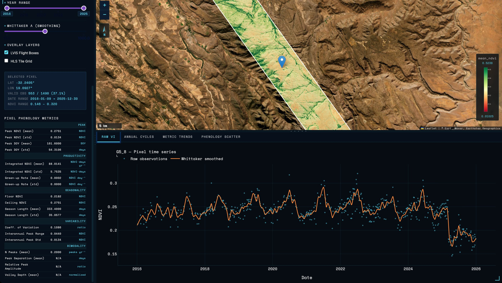

[BioSCape](https://www.bioscape.io/), the Biodiversity Survey of the Cape, uses remote sensing and field data to understand biodiversity on land and in the water across South Africa's Greater Cape Floristic Region, one of the world's 36 biodiversity hotspots. It's a US–South Africa collaboration funded by NASA, South Africa's NRF/SAEON and UNESCO, with scientists from around the world.

I did this work as a Research Collaborator with [G. Burch Fisher, Ph.D.](https://burchfisher.github.io/), an Associate Research Scientist with the **National Science Foundation–funded GCE-SCIPE program at the University of Maryland Center for Environmental Science (UMCES)**. There were two deliverables: a set of **NetCDF datacubes holding time-series phenology for every 30 m pixel**, which were used as model inputs for the BioSCape project, and the **BioSCape Phenology Explorer**, a dashboard that lets scientists visually explore and navigate the project's regions and metrics.

## How it fits together

1. **NASA HLS 2.0** imagery (Landsat 8/9 and Sentinel-2) provides the 30 m spectral time series.
2. My **[HLS VI Pipeline](/projects/hls-vi-pipeline/)** downloads, cloud-masks and turns that imagery into vegetation index time series for each LVIS flight box.
3. My **[VI Phenology](/projects/vi-phenology/)** toolkit smooths those series and builds the **CF-1.8 NetCDF phenology datacubes**, with 19 per-pixel metrics. These were the first deliverable, used as model inputs for BioSCape.
4. **BioSCape Phenology Explorer**, this dashboard and the second deliverable, puts the datacubes in front of researchers, running on NSF Jetstream2 and deployed with my [Jetstream2 Dashboard Deploy](/projects/jetstream2-dashboard-deploy/) tooling.

## What researchers can do

- Pick a study region on an interactive map of the LVIS flight boxes.
- See phenology metric maps (peak NDVI, mean VI, data coverage and 19 precomputed metrics) at near-native 30 m resolution.
- Click any pixel to extract its full time series, with Whittaker smoothing applied on the fly.
- Compare raw time series, annual-cycle composites, interannual trends and phenology scatter plots.

## A tour of the dashboard

*Annual cycles: every year's smoothed curve for one pixel, overlaid so unusual years stand out.*

*Metric trends: phenology metrics year by year, over a map of green-up rate.*

*Phenology scatter: a decade of observations folded onto one calendar year, with the mean seasonal fit.*

*Pixel metrics: the full set of precomputed phenology metrics for the selected pixel — peak, productivity, seasonality, variability and bimodality.*

## Engineering

The datacubes are rechunked to Zarr v3 for fast single-pixel reads and loaded lazily with Dask, so full cubes never sit in memory. The same code reads from a local volume or straight from Google Cloud Storage. Production runs in Docker on an NSF Jetstream2 instance.
