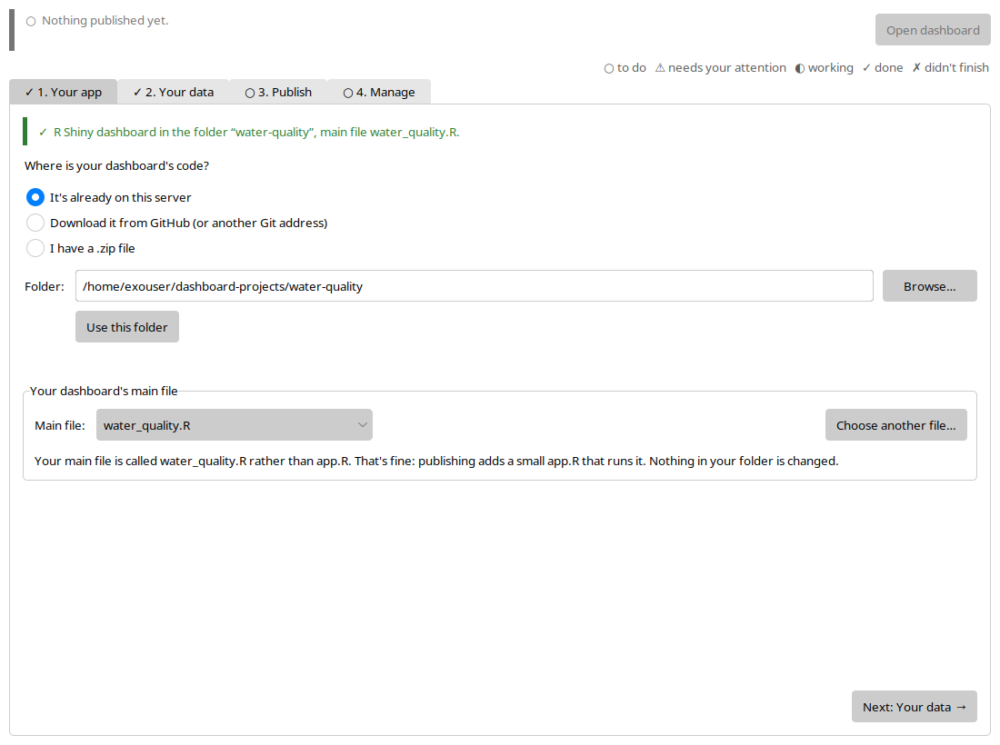
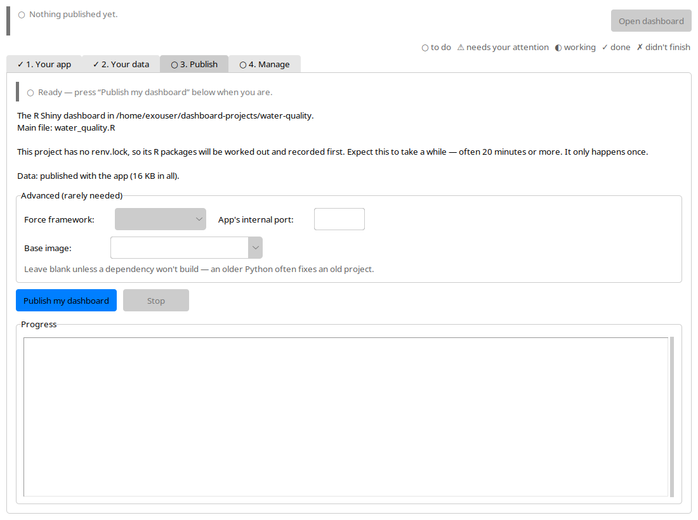

Researchers build dashboards that work on their laptops. Getting one online, permanently, means dealing with containers, reverse proxies, WSGI servers, TLS and a Linux server to keep alive. This project handles all of that for them on [Jetstream2](https://jetstream-cloud.org/), the NSF-funded research cloud that's free to U.S. researchers through ACCESS.

## What it does

*Step 1, Your app: it reads the code, reports the framework and finds the main file, even when it isn't called app.R.*

- **Detects the framework from the code itself.** It reads imports rather than guessing from filenames, and supports R Shiny, Plotly Dash, Python Shiny and Streamlit.
- **Flags laptop-only habits** before publishing: hard-coded local paths, `setwd()` and filename case mismatches, with file and line numbers.
- **Handles dependencies.** It generates a missing `renv.lock` and switches to a GDAL-ready base image when it sees a geospatial R project.
- **Keeps big data separate.** Small files ship with the app, while large datasets mount from a storage volume, so updating data takes a restart, not a rebuild.
- **Production web serving:** nginx with WebSockets, gzip, rate limiting, a maintenance page and TLS.
- **Stays up:** restart on crash, plus a watchdog that catches apps that are alive but no longer answering.
- **No terminal needed.** A desktop app walks researchers through each step and is a thin front end over the same scripts.

*Step 3, Publish: a plain-language readiness summary, including how long a first build will take, before anything is deployed. Step 4, Manage, at the top of this page, shows the dashboard live: container, health check, nginx and public responses, memory and disk.*

It's the deployment path behind the [BioSCape Phenology Explorer](/projects/bioscape-phenology-explorer/).
